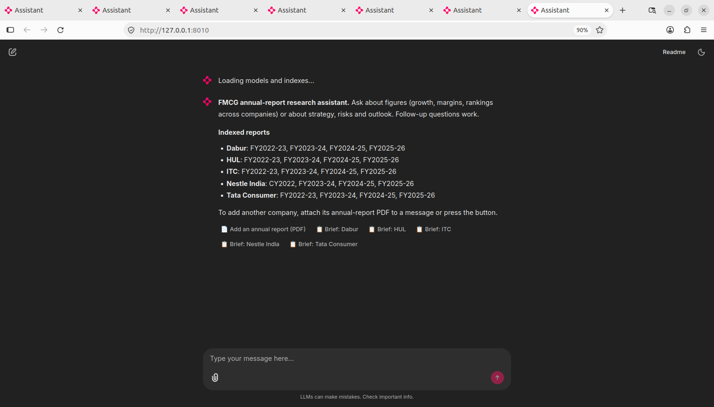
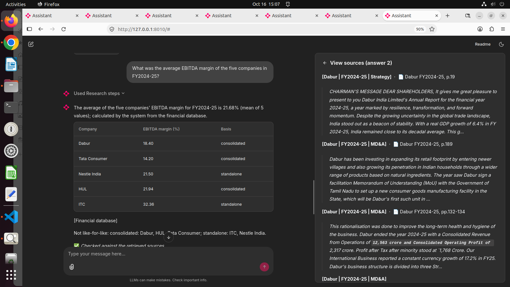
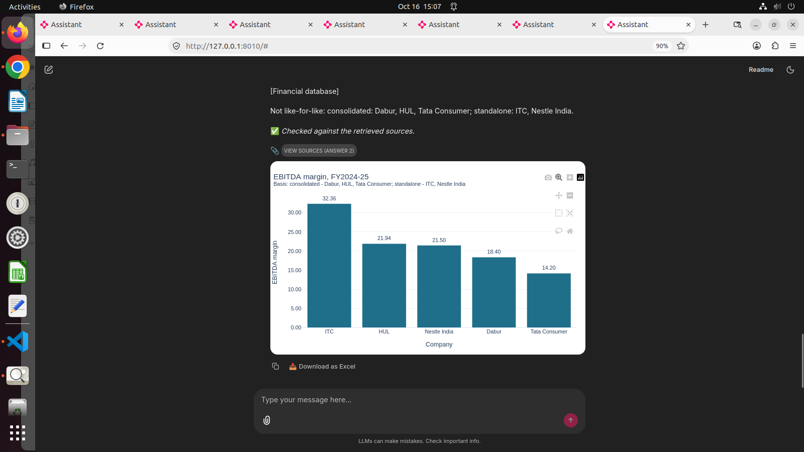
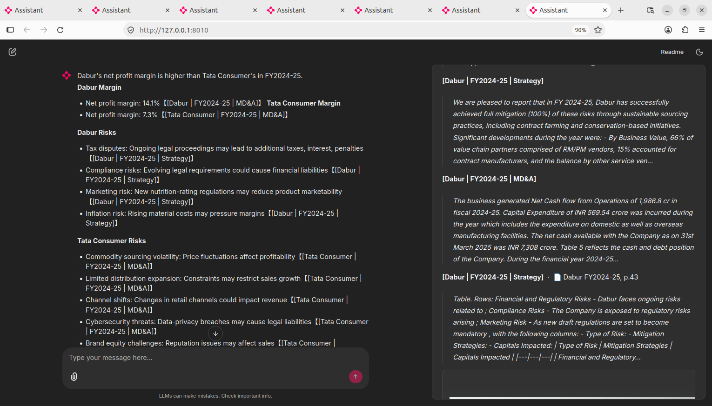
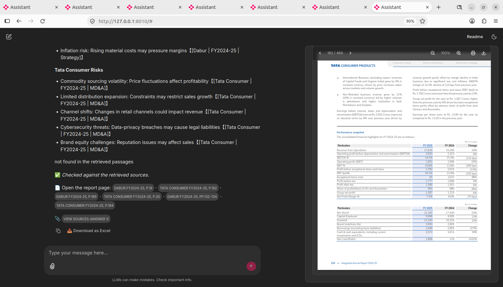
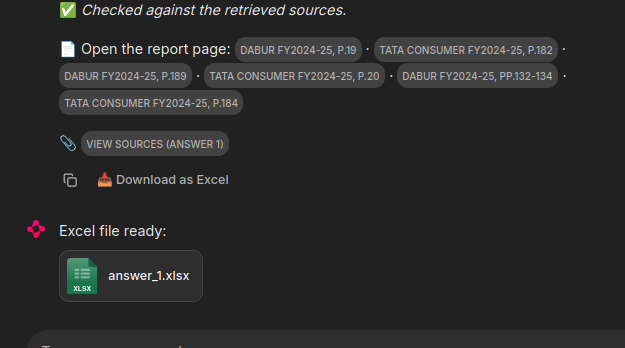
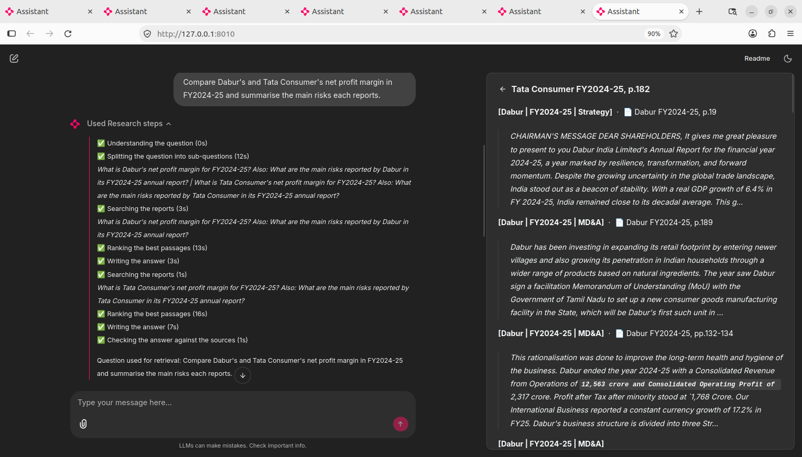
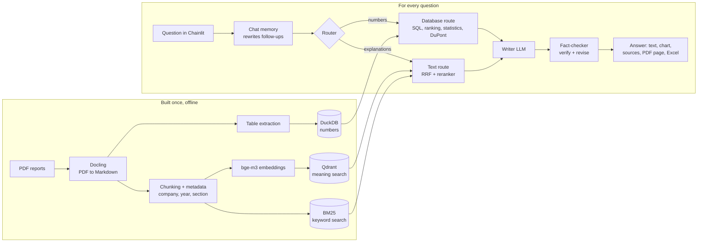
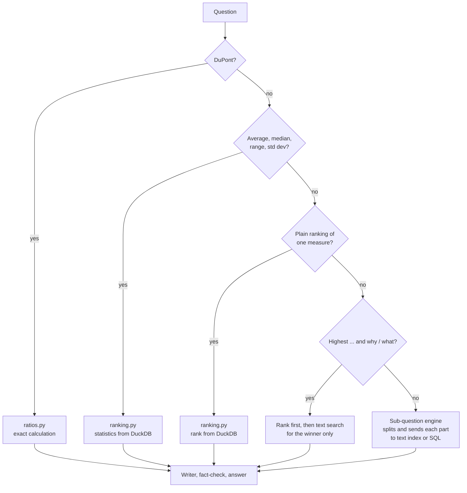
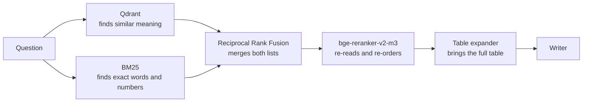

# FMCG Annual-Report RAG Assistant

A chat assistant for equity analysts. Ask a question about five Indian FMCG companies and get a short, cited answer: a number, a ranking, a chart, or a summary of what management said. It reads **20 annual reports** (ITC, HUL, Dabur, Nestlé India, Tata Consumer Products; FY2022-23 to FY2025-26) so you don't have to.




## What it can do

| You ask | You get |
|---|---|
| "Which company had the highest ROCE in FY2025-26?" | A ranked table from the database, a bar chart, links to the report pages |
| "What was the average EBITDA margin of the five companies in FY2024-25?" | An exact calculated figure (mean, median, range, standard deviation) |
| "What are Dabur's key risks?" | A short summary with company, year and section cited |
| "Highest ROCE, and what does its report say about capital efficiency?" | The ranking first, then the text answer for the winner |
| "DuPont analysis for HUL" | Net margin x asset turnover x equity multiplier |
| "Brief on Dabur" | One-click company brief: key figures, strategy, risks |

Every answer also has: a **Sources** panel, **links that open the exact PDF page**, a **Download as Excel** button, live progress steps, and a fact-check badge.





A question that mixes numbers and text is split and answered in parts:



Click a page link and the exact report page opens beside the answer. Every answer can be downloaded as Excel:





The app shows live progress while it works, and a Sources panel with the passages used:



## How it works (in simple words)

1. **Read** the PDFs once and turn them into clean text and tables (Docling).
2. **Cut** the text into small labelled pieces and **store** them in two searches: by meaning (Qdrant) and by exact words (BM25).
3. **Pull the numbers** out of the tables into a small spreadsheet-like database (DuckDB), so maths is done by code, not guessed by the AI.
4. For each question, a **router** picks the right route: database (numbers) or text search (explanations).
5. The AI **writes** the answer from that evidence only, and a **checker** verifies it against the sources.

### Big picture



### How a question is routed



### Text search in detail



## Tools used

| Step | Tool |
|---|---|
| PDF parsing | Docling |
| Chunking | `MarkdownElementNodeParser` (tables), `SemanticSplitterNodeParser` (narrative) |
| Embeddings | bge-m3 through Ollama |
| Text index | Qdrant + BM25, merged with `QueryFusionRetriever` (RRF) |
| Reranking | bge-reranker-v2-m3 |
| Numbers | DuckDB |
| Question splitting | `SubQuestionQueryEngine` |
| Memory | `CondenseQuestionChatEngine` + `ChatMemoryBuffer` |
| Writer / SQL models | `nemotron-3-nano:30b-cloud` and `qwen2.5` via Ollama (set in `.env`) |
| Verification | `FaithfulnessEvaluator` + a revise step |
| Interface and charts | Chainlit, Plotly |

## Project layout

```
app.py            Chainlit app: chat, brief, Excel, PDF page links
engine.py         Router, writer prompt, fact-check
retrieval.py      Text search: Qdrant + BM25 + RRF + reranker
financials.py     DuckDB tables and the SQL route
ranking.py        Rankings and statistics straight from the database
ratios.py         DuPont and company brief
exports.py        Excel export
charts.py         Plotly charts
ingest.py, parsing.py, chunking.py, sections.py   Parsing and indexing
scripts/          Build steps (parse PDFs, build numbers, page map, checks)
eval/             Test questions and results
```

## Run it

**1. Install (Python 3.12)**
```bash
python3.12 -m venv .venv && source .venv/bin/activate
pip install -r requirements.txt
```
**2. Models** (install [Ollama](https://ollama.com/download))
```bash
ollama pull bge-m3
ollama pull qwen2.5
ollama signin            # needed for the cloud answer model
```
**3. Settings**: copy `.env.example` to `.env` and set `LLM_MODEL`, `SQL_MODEL`, `EMBED_MODEL`.

**4. Data**: the annual-report PDFs are not in this repo. Put them in a folder per company and build the indexes:
```bash
python -m scripts.parse_pdfs
python -m scripts.build_corpus
python -m scripts.build_numbers
python -m scripts.build_page_map "<folder with the PDFs>"   # for click-to-page links
```
**5. Start**
```bash
export CUDA_VISIBLE_DEVICES=""      # reranker on CPU if the GPU is small
chainlit run app.py --host 0.0.0.0 --port 8010
```
Open http://127.0.0.1:8010.

## How we checked it

A 24-question ground-truth set (narrative, exact values, calculated, statistical) in `eval/`. Latest full run: 19/24, and the five failures were fixed and re-run to pass. Run it yourself with `python -m scripts.run_ground_truth`.

## Known limits

- Calculated values across companies (ratios, differences) are only partly covered; the system says "not available" rather than guess.
- Some figures differ by basis (standalone vs consolidated); answers state the basis.
- Nestlé FY2025-26 is not in the database.
- Quarterly results and earnings calls are not included.
- Embedded Qdrant allows one process at a time (`rm -f data/qdrant/.lock` if it complains).

## Data note

Annual reports belong to the respective companies and are not redistributed here.
